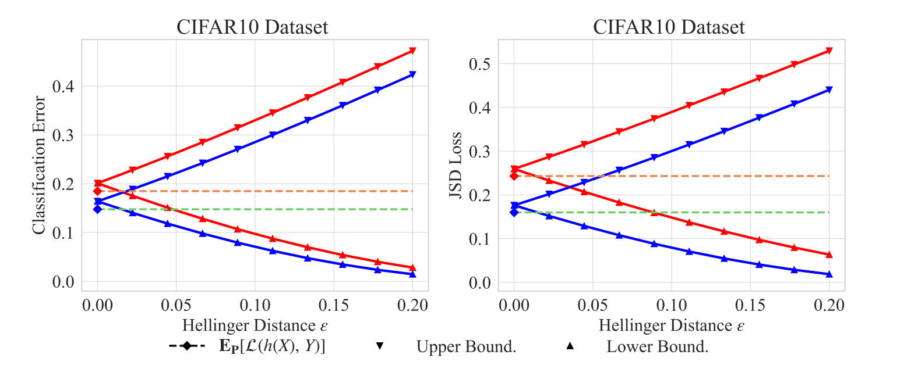

FedBGE : cơ chế phân bổ trọng số tổng hợp thông qua ước lượng cận khái quát hóa, sử dụng lý thuyết bền vững phân phối (Distributional Robustness) và moment gốc bậc 2 của hàm mất mát để ước lượng cận trên & dưới của hiệu năng khái quát hóa khi phân phối dữ liệu bị dịch chuyển. Độ chênh lệch giữa 2 cận này là thước đo mức độ lệch chuẩn và độ nhiễu tại từng client (độ lệch càng nhỏ thì khả năng khái quát hóa càng ổn định), từ đó gán trọng số tỷ lệ nghịch với độ chênh lệch (càng ổn định thì trọng số càng cao).

Bias : độ lệch của từng dự đoán so với nhãn, 1 client chỉ có chó và mèo, dự đoán ảnh oto -> lệch về chó mèo -> Bias cao

Variance : Nếu dữ liệu của 1 client bị nhiễu (20% ảnh chó bị gán nhầm nhãn thành máy bay (do chủ quan người dùng tại client đánh nhãn trong quá trình sử dụng), mỗi batch học sẽ kéo mô hình giật cục theo 1 hướng -> loss trên từng mẫu nhảy liên tục (mẫu có loss cao hoặc thấp) -> variance cao (mô hình bất ổn, nhạy cảm với nhiễu)

Tổng sai số kiểm thử : 1 mô hình local tốt (trọng số cao) phải là mô hình vừa có bias thấp (không bị lệch nhãn dự đoán) vừa có variance thấp (ít nhạy cảm với nhiễu)

$$
\text{Tổng Sai Số} \approx \text{Bias}^2 + \text{Variance}
$$

Moment gốc bậc 1 của hàm Loss : trung bình cộng của loss trên các mẫu trong tập dữ liệu $E[L]$

Moment gốc bậc 2 của Loss : trung bình cộng của bình phương hàm loss $E[L^2]$

Lý do chọn Moment gốc bậc 2 thay vì bậc 1

* Bắt được cả Bias và Variance với 1 đại lượng, khi mà $V(X) = E(X^2)-E^2(X)$

$$
E[\mathcal{L}^2] = \underbrace{(E[\mathcal{L}])^2}_{\approx \text{Bias}^2} + \underbrace{V[\mathcal{L}]}_{\text{Variance}}
$$

Khi Loss nhỏ , 0 < L < 1 , mô hình đã học khá tốt -> hàm $L^2$ nằm thoải hơn hàm L -> giúp mô hình ổn định hơn và ngược lại, khi L> 1 , Loss vọt lên nhanh hơn giúp phóng đại sai số của các client có dữ liệu nhiễu

**Vấn đề trong FL:** Client $j$ huấn luyện mô hình trên tập dữ liệu cục bộ của riêng nó (gọi phân phối này là $P$). Nhưng mục tiêu của chúng ta là ghép mô hình đó lên Server để chạy trên dữ liệu của toàn thế giới (gọi phân phối mục tiêu đó là $Q$). Vì dữ liệu ở mỗi máy trạm là Non-IID, phân phối $P$ ở máy trạm luôn khác với phân phối $Q$ ở ngoài đời thực — hiện tượng này gọi là **dịch chuyển phân phối (Distributional Shift)**.

Thước đó Hellinger H(P, Q) L:đo sự khác biệt giữa 2 phân phối xác suất (P, Q) , giá trị nằm trong khoảng 0-> 1, trả lời câu hỏi : Nếu đem mô hình của client j (vốn học ở data có phân phối P) đem đi chấm điểm trên 1 tập mới với pp Q bị lệch đi 1 khoảng tối đa $\epsilon$ , thì Loss bình phương trên bộ Q này biến thiên trong khoảng nào

# Các bước thực hiện

B1 : Đo sức khỏe cục bộ tại từng client bằng trung bình và variance của $L^2$

Client i lấy mô hình vừa học xong, chấm điểm lại trên toàn bộ $n_i$ mẫu tại client, thu được n $Loss^2$ cho n mẫu, tính được kỳ vọng $Loss^2$ ($E_P[L^2]$) : trung bình cộng và phương sai $Loss^2$ : $V_P[L^2]$ : phương sai của các bình phương đó

B2 : Có được kì vọng và phương sai loss bình phương theo dataset với phân phối P trên client j , giả định môi trường mới với phân phối Q (dataset mới) bị lệch 1 khoảng Hellinger so với P tối đa là $\epsilon$ . Sai số $E_Q[L^2]$ ở môi trường mới sẽ không vượt quá cận trên $u_j$ và cận dưới $l_j$ của client j, với công thức tính cận trên (kịch bản tệ nhất khi đem đi test) và cận dưới (kịch bản tốt nhất)

$$
u_j = \underbrace{E_P[\mathcal{L}^2]}_{\text{Lỗi gốc}} + \underbrace{2\lambda_\epsilon \sqrt{V_P[\mathcal{L}^2]}}_{\text{Độ bất định do phương sai}} + \underbrace{\Delta_\epsilon^u}_{\text{Phần phạt dịch chuyển trên}}
$$

$$
l_j = \underbrace{E_P[\mathcal{L}^2]}_{\text{Lỗi gốc}} - \underbrace{2\lambda_\epsilon \sqrt{V_P[\mathcal{L}^2]}}_{\text{Độ bất định do phương sai}} - \underbrace{\Delta_\epsilon^l}_{\text{Phần phạt dịch chuyển dưới}}
$$

Trong đó , $\lambda_\epsilon= \sqrt{\epsilon^2(2-\epsilon^2)(1-\epsilon^2)^2}$ là 1 hệ số tỉ lệ thuận với $\epsilon$, khi $\epsilon=0 $ : môi trường mới không khác môi trường cũ -> $\lambda_\epsilon$ và $\Delta_\epsilon^u$=0, hay kì vọng không thay đổi, cận trên cận dưới chập làm 1, khi $\epsilon$ tăng dần, 2 cận cách dần nhau ra bởi $\sqrt{V_p[L^2]}$

Vậy là, nếu client có dữ liệu sạch và đồng nhất (Bias thấp, Variance thấp), mọi mẫu đều có loss gần tương đương nhau -> phương sai $V_P[L^2]$ rất nhỏ -> 2 cận bám sát nhau và ngược lại

B3 : Đo độ bất định tổng thể bằng cách quét nhiều mức dịch chuyển

Thay vì chỉ thử 1 mức $\epsilon$ duy nhất, để đánh giá toàn diện mô hình cục bộ từ lúc dữ liệu dịch chuyển nhẹ đến mạnh, thuật toán chia đoạn $[0, \epsilon]$ thành nhiều mốc nhỏ cách nhau $\Delta \delta$ , tại mỗi mốc thứ i, client đo biên độ dao động của cận trên và dưới tại các mốc , biên độ này với IID nhỏ hơn non-IID ở cùng mốc

$$
\sigma_j^{(i)} = \Vert u_j^{(i)} - l_j^{(i)} \Vert
$$

Sau đó lấy tổng các mốc để có tổng độ chênh lệch cận của client j ở vòng giao tiếp t

$$
\eta_j^t = \sum_{i=1}^{\epsilon / \Delta\delta} \sigma_j^{(i)}
$$

$\eta_j^t$ : diện tích vùng nằm giữa 2 đường biểu diễn của cận trên và dưới, càng nhỏ thì phễu càng hẹp -> mô hình cục bộ đáng tin cậy hơn (dù phân phối môi trường thay đổi thì loss cũng được kẹp trong vùng nhỏ) -> trọng số lớn và ngược lại

B4 : Nghịch đảo độ bất định để tính trọng số tổng hợp

Client gửi mô hình sau train tại vòng t và $\eta_j^t$ lên server. Server nghịch đảo $\eta_j^t$ (vì càng lớn thì trọng số càng thấp), rồi chia cho tổng nghịch đảo (để tổng bằng 1)

$$
\theta_j^t = \frac{1 / \eta_j^t}{\sum_{k=1}^K \left(1 / \eta_k^t\right)}
$$

Tổng hợp mô hình mới 

$$
w^{global, t+1} = \sum_{j=1}^K \theta_j^t w_j^{t+1}
$$

Nhược điểm : yêu cầu hàm mất mát phải bị chặn trên ($\mathcal{L}\le M$). Điều này gây khó khăn khi áp dụng trực tiếp với hàm Cross-Entropy tiêu chuẩn vốn không bị chặn trên, đòi hỏi phải sử dụng các hàm loss thay thế (như JSD loss) hoặc cơ chế cắt ngọn.
